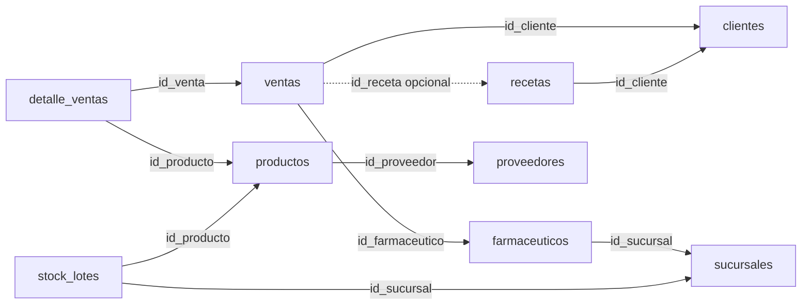
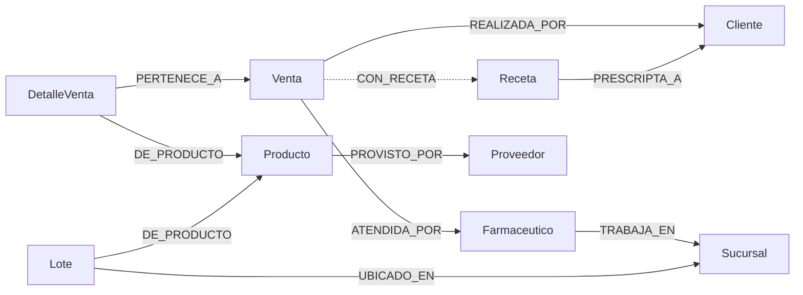

# FarmaRed: modelo y contratos propuestos

El contrato de proyección implementado se basa en los nueve CSV. Las decisiones
de negocio y de integración pendientes de acordar están al final.

## MongoDB: fuente de verdad

MongoDB conserva catálogo, clientes, recetas, ventas y stock. Las altas y bajas,
las dispensas y los descuentos se confirman allí. Una transacción del replica
set permite confirmar o revertir conjuntamente las escrituras de una venta.

| Colección | ID único | Referencias y campos relevantes | Campos opcionales |
| --- | --- | --- | --- |
| `clientes` | `id_cliente` | DNI también único. Baja lógica con `activo: false`. | `nro_afiliado` |
| `sucursales` | `id_sucursal` | Distingue Farmacia de Droguería. | |
| `farmaceuticos` | `id_farmaceutico` | `id_sucursal`. Matrícula también única. | |
| `proveedores` | `id_proveedor` | Datos de origen. | |
| `productos` | `id_producto` | `id_proveedor`. | |
| `stock_lotes` | `id_lote` | `id_producto`, `id_sucursal`. El número de lote puede repetirse en distintas sucursales. | |
| `recetas` | `id_receta` | `id_cliente`, estado y dispensas. | `proxima_dispensa` |
| `ventas` | `id_venta` | `id_cliente`, `id_farmaceutico`, fecha, tipo, medio de pago, total y estado. | `id_receta` |
| `detalle_ventas` | `id_detalle` | `id_venta`, `id_producto`, cantidad y precio unitario de la operación. | |

Se mantienen las colecciones e IDs que ya creó el loader. El detalle queda
separado para preservar sus identificadores, consultar unidades por producto
y mantener la carga existente. El servicio de venta deberá escribir cabecera y
detalles en la misma transacción. El total se calcula como la suma de
`cantidad × precio_unit` de cada detalle; los importes se guardan como enteros
en pesos. Los IDs, DNI, matrículas y teléfonos se guardan como texto. Los
opcionales vacíos del CSV se guardan como `null` en MongoDB.

Las flechas van del documento que guarda la referencia al documento referido.



Los índices únicos cubren los IDs y las dos claves adicionales. El loader
también crea índices para productos activos, ventas por estado y fecha, detalle
por venta, lotes por unidades y búsqueda FEFO por sucursal, producto, vencimiento
e ID. Para aplicar estos índices a una base ya cargada basta repetir el loader:
inserta faltantes y conserva los documentos existentes.

### Carga MongoDB (T05)

[`load_mongo.py`](../scripts/loaders/load_mongo.py) lee los nueve CSV de
`data/original/` y, si existen, los de `data/adicionales/` (mismos encabezados;
cada archivo es opcional). Los originales no se modifican. IDs, DNI,
matrículas, referencias y totales se validan sobre el conjunto unido antes de
conectar, y un error indica el archivo y la línea.

- **Carga aditiva (por defecto).** Un upsert con `$setOnInsert` por ID de
  origen inserta lo que falta y no toca lo existente. Repetirla no revierte
  altas, bajas, dispensas ni descuentos hechos por q13–q15 (D12).
- **Stock.** `stock_lotes.csv` ya refleja las ventas históricas y se inserta
  tal cual: la carga nunca descuenta stock a partir de las ventas.
- **Verificación.** Después de cada carga, y con `--verificar` sin escribir,
  se lee un snapshot y se informa por colección: faltantes (error), documentos
  modificados con sus campos (esperable tras operaciones), documentos propios
  de la base (altas de q13/q14), IDs repetidos y documentos que no cumplen el
  contrato de tipos y referencias de `preparar_proyeccion`.
- **Reinicio explícito.** `--reiniciar NOMBRE_BASE` borra solo las nueve
  colecciones y vuelve a cargar. Exige el nombre de la base configurada, para
  no ejecutarlo contra otra por error.
- **Transición desde la carga exploratoria.** Un documento anterior con otro
  formato (por ejemplo, una fecha como texto) se conserva con la carga aditiva
  y la verificación lo marca como incumplimiento del contrato. Si hay IDs
  repetidos, falla la creación del índice único y el loader lo informa. En
  ambos casos la salida es `--reiniciar`. Se comprobó en bases aisladas con
  [`verify_mongo.py`](../tests/carga/verify_mongo.py).

**Interfaz con el grafo (T06).**
[`leer_snapshot(client, db)`](../src/utils/datos_mongo.py) devuelve las nueve
colecciones sin `_id`, ordenadas por ID y leídas en una sesión `snapshot`, con
la forma que acepta `preparar_proyeccion`. T06 usa esta función como fuente
de la proyección.

## Neo4j: proyección de lectura

El grafo permite recorrer el historial de un cliente y su atención en sucursales
sin volver a expresar todas las relaciones en cada consulta. Se conservan las
etiquetas e IDs actuales, sus restricciones de unicidad y las relaciones de
[`datos_csv.py`](../src/utils/datos_csv.py).



q03 reúne las ventas y recetas que apuntan al cliente. q04 cuenta sus recetas
y q06 parte de la receta para obtener el cliente. q10 recorre las atenciones
entre sucursal y cliente a través del farmacéutico y la venta. q12 parte de
todos los clientes y comprueba la ausencia de ventas en el período.

### Contrato implementado y entrada para T05

[`preparar_proyeccion`](../src/utils/proyeccion_neo4j.py) recibe un conjunto
completo de registros agrupados por las nueve colecciones de la tabla. Para
cada colección proyecta los campos definidos en `ENTIDADES` y descarta los
campos internos de MongoDB, como `_id`. Conserva IDs, DNI y matrículas como
texto, cantidades e importes como enteros y `activo` como booleano.

Las fechas llegan tipadas desde el CSV o como `datetime` de BSON. Se toma el
día UTC y se envía a Neo4j como una fecha sin hora. Los opcionales ausentes,
vacíos o nulos se normalizan a `None`. Una venta con `id_receta` nulo queda
sin `CON_RECETA`. Si la venta informa una receta, la referencia debe existir.

La validación se comparte con el lector de CSV. El contrato comprueba IDs
repetidos, campos obligatorios y referencias en memoria antes de escribir en
Neo4j. Conserva los nodos inactivos, sus vínculos históricos y la fecha de
origen de RC002. El cargador usa el contrato tanto al publicar en Neo4j como
en `python scripts/loaders/load_neo4j.py --dry-run`.

### Reconciliación del grafo en T06

El cargador aplica las filas normalizadas en una sola transacción de Neo4j.
Identifica los nodos por etiqueta e ID de origen, actualiza sus propiedades y
quita los opcionales que pasan a `null`. Para cada referencia conserva un solo
vínculo al destino indicado y quita los anteriores. Si una venta pierde su
referencia a la receta, se quita `CON_RECETA`. Una baja lógica actualiza
`activo` y conserva el nodo y sus relaciones históricas. Los cambios abarcan
los registros incluidos en la entrada.

En Neo4j 5.26 se compararon propiedades y destinos después de dos cargas de
los originales. Ambas dieron 103 nodos y 151 relaciones. Se repitió la prueba
con un cambio de contacto, una baja lógica, un cambio de sucursal y el retiro
de una receta. Una referencia obligatoria inválida y un fallo provocado dentro
de la transacción conservaron el último estado válido.

### Sincronización desde MongoDB en T06

[`sincronizar_grafo(db_mongo, sesion_neo4j, consulta=None)`](../src/services/sincronizacion_neo4j.py)
inicializa las restricciones y toma un bloqueo de escritura sobre el nodo
`ControlProyeccion` antes de llamar a `leer_snapshot`. En la misma transacción
de Neo4j reconcilia los nodos y vínculos y quita de la proyección los IDs que
salieron de la fuente, por ejemplo después de un reinicio de MongoDB. Las bajas
lógicas siguen presentes en el snapshot con `activo=False`. El bloqueo se
libera al confirmar o revertir. Cada reintento vuelve a tomar el bloqueo y
abre un snapshot nuevo.

El cargador usa esa función para publicar el snapshot. Las consultas del grafo
pueden pasar una función de lectura que reciba la transacción y materialice su
resultado. La lectura se ejecuta después de reconciliar y el resultado se
devuelve después del commit. La proyección representa el punto de lectura de
MongoDB. MongoDB y Neo4j confirman sus transacciones de forma independiente.

Ante un fallo de lectura, validación o publicación se informa el error y se
descarta el resultado de la consulta. Un rollback confirmado conserva el
grafo anterior. Si se pierde la conexión durante el commit de Neo4j, se
informa que el resultado de la confirmación quedó indeterminado y se puede
volver a sincronizar.

**Verificación.** En MongoDB 8.0.16 y Neo4j 5.26, dos refrescos dieron los
mismos 103 nodos de negocio y 151 relaciones. Con tres registros adicionales
temporales se comprobaron la carga repetida, el cambio de contacto y la baja
lógica con historial. Una escritura multicollección entre dos lecturas del
snapshot se vio completa en el siguiente refresco. Con dos refrescos
simultáneos, el segundo esperó el bloqueo antes de leer MongoDB. Una referencia
inválida y un fallo de escritura conservaron el grafo anterior.

La verificación de T07 se completó con diez filas propias por cada uno de los
nueve datasets. Dos sincronizaciones consecutivas conservaron 193 nodos de
negocio y 247 relaciones, sin duplicaciones.

**Escenario para T15.** En un entorno de prueba, sincronizá una vez, detené
Neo4j con `docker compose stop neo4j` y modificá un cliente en MongoDB. Ejecutá
el cargador y verificá el error con código `1`. Volvé a levantar Neo4j con
`docker compose up -d --wait neo4j`, repetí el refresco y comprobá que el cambio
del cliente aparece en el grafo. La llamada con `consulta` debe propagar el
error mientras Neo4j está caído.

Para q10, los CSV solo permiten inferir la sucursal de ventas históricas con la
asignación disponible del farmacéutico. Se propone guardar `id_sucursal` en
ventas nuevas como dato de la operación, para no reinterpretar su historial
si el farmacéutico se muda de sucursal.

## Fechas y contratos de venta para T12–T14

Firmas propuestas para revisar con A y C.

```python
q14(db, id_venta, id_cliente, id_farmaceutico, medio_pago, items, id_receta=None)
q15(db, id_venta, sesion)
```

- El día de negocio se calcula en `America/Argentina/Buenos_Aires`. Una fecha
  sin hora se codifica como medianoche UTC en MongoDB y como `Date` en Neo4j.
  Los límites mensuales incluyen el primer día y excluyen el primer día del
  mes siguiente. Se propone considerar utilizable un lote hasta su fecha de
  vencimiento inclusive.
- q14 recibe un ID estable de venta, cliente, farmacéutico, medio de pago, una
  lista de ítems con `id_producto` y `cantidad`, y una receta opcional. Valida
  actividad, sucursal tipo Farmacia, cantidades y receta según los productos.
  Guarda el precio vigente y devuelve `id_venta` y `total` una vez confirmada
  la operación.
  El día se determina una vez por operación, también ante reintentos del driver.
- q15 recibe el ID de venta y la misma sesión activa de q14. Lee la venta y sus
  detalles, agrupa cantidades por producto y consume lotes de su sucursal por
  vencimiento ascendente y luego por `id_lote`. Un rechazo de stock se propaga
  a q14 para revertir la operación completa. q15 devuelve el reparto del
  descuento con `id_producto`, `id_lote` y unidades descontadas. q14 es dueña de
  la sesión y de la confirmación de venta, receta, detalles y stock.
- Propuesta de reintento: la misma clave con los mismos argumentos devuelve
  el resultado de la operación anterior; reutilizarla con otros argumentos
  da conflicto. La protección se persiste junto con la venta y el descuento.
  q15 no se expone como un descuento independiente; si se ofrece por terminal
  para una venta existente, debe usar la misma protección transaccional para
  evitar un segundo descuento.
- La dispensa se cuenta una vez por venta con receta. En tratamientos
  prolongados, la próxima se fija a 30 días mientras queden dispensas; al
  completar la receta se limpia la fecha. RC002 se conserva tal como vino.

### Estado de la implementación (T12, T13 y T14)

q14 invoca q15 dentro de su transacción. q15 usa `venta.id_sucursal` y
`venta.fecha` para elegir lotes y guarda el reparto en `venta.registro.descuento`.
Si se vuelve a invocar con esa venta, devuelve el reparto guardado. Si falta
stock, lanza `ErrorStock` con código `stock_insuficiente` y q14 aborta la
operación. Las [pruebas de T14](evidencias/q14.md) usan q15 real y verifican la
reversión después de registrar la dispensa y después de descontar stock. Los
casos por lote se documentan en la [evidencia de q15](evidencias/q15.md).

Las ventas nuevas agregan dos campos que no están en el CSV: `id_sucursal`
(para q10, pendiente de confirmar con B y D) y `registro` (solicitud, dispensa
y descuento, para los reintentos). La proyección al grafo los ignora.

## Validaciones pendientes con el equipo

| Integrantes | Acuerdo pendiente |
| --- | --- |
| A, B y C | Confirmar firmas, retornos, errores y regla de reintento de q14/q15. Resolver el vencimiento del lote en el día y cómo ejecutar q15 desde la terminal. |
| A, B y C | Acordar criterios de vigencia de una receta sin fecha de vencimiento, si se puede dispensar antes de `proxima_dispensa` y cuándo una venta puede usar una receta para varios productos. |
| B, C y D | Confirmar si las ventas nuevas guardan `id_sucursal` para q10. Cubrir con datos de prueba una venta histórica atendida por un farmacéutico inactivo. |
